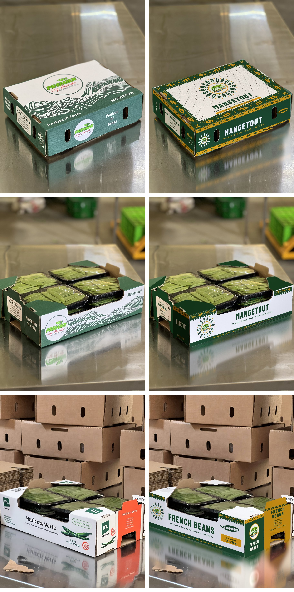

# Fresca export cartons – redesign

## Status (12 Oct 2026)
- **2 kg lidded carton, mangetout:** approved by the client (`approved/`).
- **2 kg lidded carton, French beans:** done in the same design (`mockups/approved/`).
- **12 × 250 g trays, mangetout and French beans (current direction):** the approved carton design printed on the
  trays the client ships today, which stack. Shown on the client's own photos in `mockups/family/`; the panels are in `art/family/`.
  Rebuild: `node box-art.js family/` and then `.venv/bin/python box-mockup.py IMG_57 family` (in `04_tools`).
- **12 × 250 g display tray (below):** an earlier proposal. The client turned it down because a tall header does not stack in shipping.
- The "Kanga" and lid studies further down were earlier explorations; the client chose the approved design instead.

## New display tray (12 × 250 g)
A shelf-ready tray replaces the old open tray. Outside 390 × 290 mm.
- **Tall double-layer header (200 mm):** folds over its top crease and hangs inside, so the brand faces the shopper above the punnets. One-side print, two layers of board.
- **Side walls sweep** from 200 mm at the back down to 75 mm at the front.
- **Front lip (75 mm)** with an 18 mm thumb dip, so punnets lift out and the produce shows.
- **Glue flaps** on the front and back walls, glued inside the side walls. No hand holes.
- **Same look as the approved carton:** Avenir Next, forest / mid green / gold on white board, and a kraft inside.

| | |
|---|---|
| `dielines/<product>-tray-dieline.pdf` | 1:1 flat blank, print side up: cut (black), crease (red dashed), glue (hatched), dimensions |
| `art/tray/<product>/` | the panel artwork (10 px/mm) used by the die-line and the renders |
| `mockups/trays/` | 3D renders: hero, front, back, from above, empty, and both trays together |

Rebuild: `node tray-build.js && node tray-render.js && .venv/bin/python tray-finish.py` (in `04_tools`).
Geometry and art live in `tray-spec.js`; change a dimension there and both the die-line and the renders follow.

New artwork for the Fresca boxes, shown on the client's own photos of the current (Premier Veg Mondo / Mitrofresh) cartons.



## The design: "Kanga"
Built on the East African kanga cloth: a patterned border (*pindo*), a centre field and a printed message (*jina*).
Every motif is drawn from the product itself. The border repeats open pea pods, the centre medallion is a ring of
pods around the Fresca logo, and the *jina* reads **MAZAO BORA KUTOKA KENYA** ("quality produce from Kenya").

- **Two inks only, plus the logo:** forest `#1e4a2e` and marigold `#e8a317` on white board, so the cartons are cheap to flexo-print.
- **Type:** Barlow Condensed for names, Barlow for small text, so it reads from across a cold store.
- **The same system everywhere:** lidded 2 kg export carton (lid, sides, ends), the open 12 × 250 g mangetout tray, and the French-bean display tray.
- Product names come with the importers' languages (FR / NL / DE / ES). Weights and grades come from the website's product data.

Two alternative lid directions are in `mockups/kraft` (a shipping manifest printed on brown board) and `mockups/field`
(one big pod on a full forest flood). They only change the lid.

## Folders
| Folder | What |
|---|---|
| `photos/` | the client's original carton photos (HEIC → JPEG, orientation fixed) |
| `art/kanga/` | flat print panels, 10 px per mm (lid 400×300, side 400×110, end 300×110 mm, tray panels) |
| `art/kraft/`, `art/field/` | alternative lids |
| `mockups/<concept>/` | the new artwork on each photo |
| `scenes.json` | where each box face sits in each photo (corners, cut-outs, reflections) |

## Rebuilding
```
cd 04_tools
node box-art.js                       # all flat panels -> 06_packaging/art
python3 -m venv .venv && .venv/bin/pip install numpy opencv-python-headless
.venv/bin/python box-mockup.py        # every photo, Kanga concept
.venv/bin/python box-mockup.py IMG_5733 kraft   # one photo, other lid
```
`box-mockup.py` warps each panel onto its face, lights it using the shading of the old print in the photo,
keeps the real hand-holes and cut edges, repaints the old green on flaps and posts, and redraws the reflection in the steel table.
`box-match.py` finds a face in a new photo of the same carton by feature-matching (it was used to place the faces in IMG_5729, 5737, 5761 and 5764).

## Before printing
These are presentation mockups. Before the printer gets them:
- get the converter's die-line for each carton and re-flow the panels onto it (bleed, glue flap, hand-hole positions);
- convert the two inks to Pantone or flexo specs and confirm the logo can be printed (it is full colour, so it is usually a label or a 4-colour patch);
- confirm the class, net and gross weights for each SKU.
